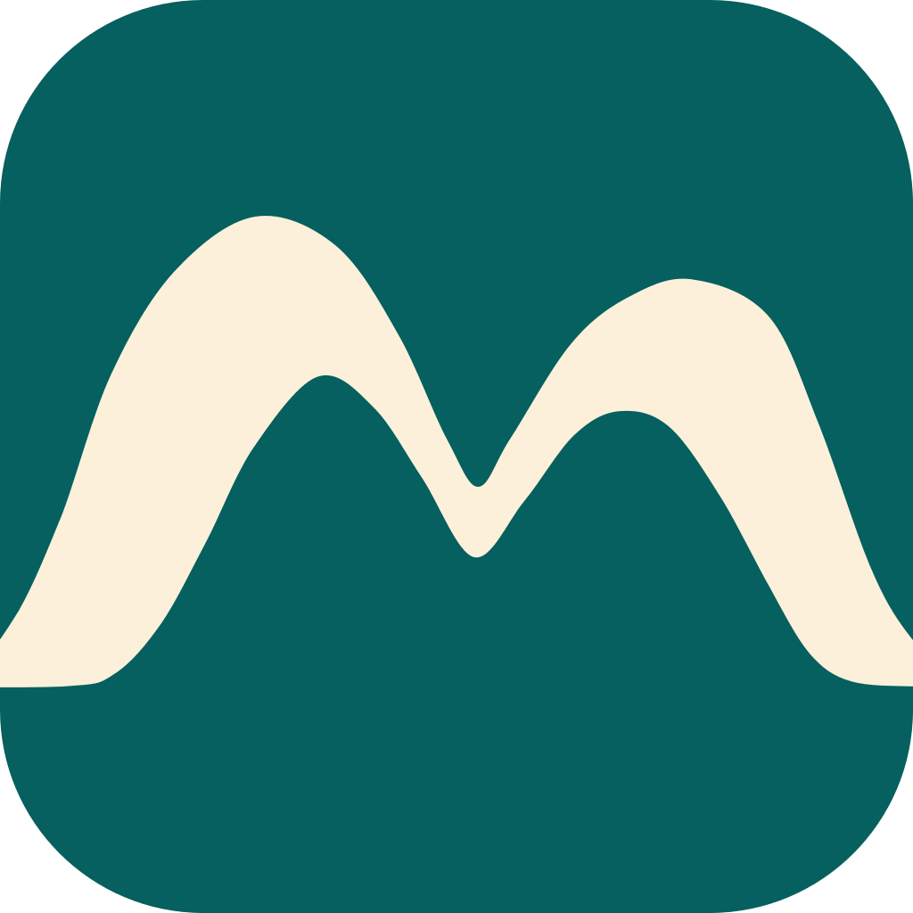

# MadeGood

Open-source tracking for time on the water, on iPhone, Apple Watch, and the web.

- **Sessions** (watch-first): workout tracking for sailing, windsurfing,
  motorboating, kayak, canoe, and SUP, with sport-specific metrics such as tacks
  and gybes, VMG, speedsurfing categories, and stroke rate.
- **Voyages** (iPhone-first): a passage log over hours or days, routes and
  waypoints, live position sharing, and boat instruments over NMEA 0183 / Signal K.

Local-first: it works offline with no account. Sync and the website at
[madegood.app](https://madegood.app) are optional.

## Status

Early development (Phase 0: foundations). Nothing is released yet. See
[docs/PLAN.md](docs/PLAN.md) for the plan and roadmap.

## Contributing

Start with [CONTRIBUTING.md](CONTRIBUTING.md) (we use the DCO) and
[AGENTS.md](AGENTS.md) for commands and conventions. Please follow the
[Code of Conduct](CODE_OF_CONDUCT.md) and report security issues as described in
[SECURITY.md](SECURITY.md).

## License

[Apache License 2.0](LICENSE). See [NOTICE](NOTICE).

Created in [T3 Code](https://t3.codes).
